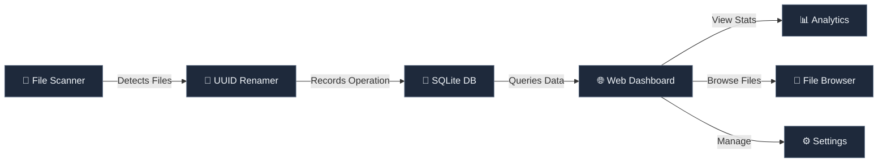
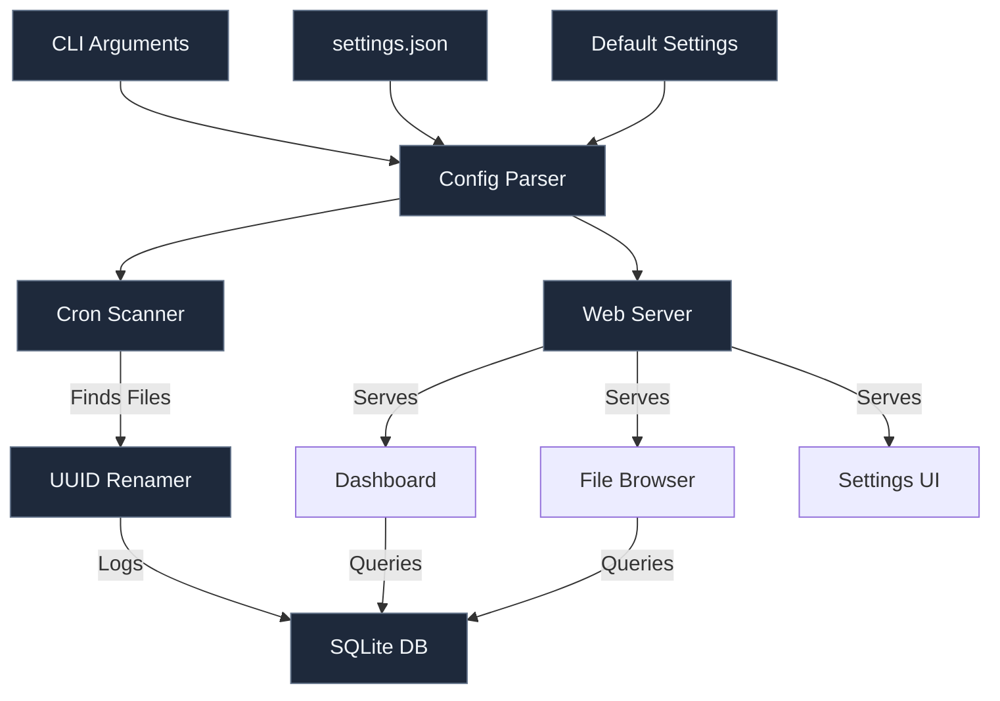

# Auto-Rename - File UUID Renamer with Web Interface

**A Go application that renames files to UUID-based names with SQLite database logging and web interface for monitoring.**

  

---

## Quick Links

- **Getting Started**: [Setup](#setup) | [CLI Usage](#usage) | [Docker](#docker-deployment)
- **API**: [Endpoints](#api-endpoints) 
- **Features**: [Dashboard](#dashboard) | [File Browser](#file-browser) | [Media Viewer](#media-viewer) | [Settings](#settings)

---

## Features Overview



- **File Renaming** - UUID-based automatic file renaming with dry-run preview
- **Dashboard** - Server-side rendered statistics, recent operations, cron status monitoring
- **File Browser** - Navigate directory structure, view file metadata (size, modification time)
- **Media Viewer** - Professional image zoom/rotate and video playback with Video.js & Viewer.js
- **Records & Logs** - Search, filter, and paginate rename history with status tracking
- **Settings** - Runtime configuration for paths, cron expressions, and format options
- **Web API** - JSON endpoints for programmatic access

---

## Quick Start

### Local Development

```bash
# Clone and setup
git clone <your-repo-url>
cd auto-rename
go mod tidy

# Build
go build -o auto-rename ./cmd/auto-rename

# Create test files
mkdir test-files
echo "test content" > test-files/document.txt

# Preview changes (dry run)
./auto-rename -dir=./test-files -dry-run

# Actually rename files with web interface
./auto-rename -dir=./test-files -web-port=8080

# Rename files with cron scanning (every 30 minutes)
./auto-rename -dir=./test-files -cron -cron-expr="*/30 * * * *" -web-port=8080
```

### Docker Usage

```bash
# Build image
docker build -t auto-rename:latest .

# Run with mounted directory
docker run -v $(pwd)/test-files:/app/files auto-rename:latest -dir=/app/files -dry-run

# Using Docker Compose (Recommended)
docker compose up -d

# View logs
docker compose logs -f auto-rename

# Access web interface at http://localhost:8768
```

### Common Cron Expressions

- `*/1 * * * *` - Every minute
- `*/5 * * * *` - Every 5 minutes
- `*/30 * * * *` - Every 30 minutes
- `0 * * * *` - Every hour
- `0 0 * * *` - Daily at midnight

---

## Building with Make

Fast, optimized builds with Docker layer caching:

```bash
# Standard build (10-15s with cache)
make build

# Force rebuild without cache
make build-no-cache

# Advanced build with cleanup
make build-advanced

# Show all targets
make help
```

**Performance:**
- Source code changed: **10-15 seconds** (cached dependencies)
- Dependencies changed: **60-90 seconds**
- First build: **80-120 seconds**

The Dockerfile uses multi-stage builds and optimized layer ordering:
1. Dependencies (`go.mod`, `go.sum`) - cached separately
2. Source code (`cmd/`, `internal/`) - changes frequently
3. Assets - only in final stage

---

## Web Dashboard Features

### Modern UI Design (Complete Refactor - Jan 2026)
The web interface features a **premium liquid glass aesthetic** with:
- **Dark-first design** with light mode toggle via localStorage
- **Glassmorphism effects** - Frosted glass cards with backdrop blur and gradient borders
- **Custom typography** - Instrument Serif for titles, Poppins for UI, Fira Code for data
- **Smooth animations** - 0.3s transitions, 2px hover lift, gradient shadows
- **Responsive layout** - Desktop, tablet, mobile optimized
- **Dual-mode support** - Dark theme (default) and light theme with full CSS color remapping
- **Accessible color system** - Success (green), Error (red), Primary (indigo), Warning (amber)

### Dashboard Page (`/`)
- **Quick Stats** - 4-card layout showing total, successful, failed, and 24h activity
- **Server Status** - Real-time server time and cron job monitoring
- **Recent Operations** - Live table of latest file renames with status badges
- **Quick Actions** - Scan trigger, records, API access buttons
- **Server-Side Rendering** - Complete HTML on first load, no loading spinners

### Records Page (`/records`)
- **Advanced Search** - By original filename or UUID with live filtering
- **Smart Filters** - Status (success/failed), date range selection
- **Pagination** - 20 records per page with navigation
- **Responsive Table** - ID, Original Name, New UUID, File Path, Size, Status, Timestamp
- **Status Badges** - Visual success/error indicators with color-coded styling

### Settings Page (`/settings`)
- **Organized Sections** - File Paths, Server, Cron, Formatting, Behavior
- **Real-time Updates** - Settings persist immediately, live configuration
- **Current Config Display** - Shows active settings with last update timestamp
- **Custom DateTime Formats** - Presets + custom Go time layout support
- **Behavior Toggles** - Dry-run, Web-only, Subfolder renaming options

### Logs Page (`/logs`)
- **Chronological History** - Full operation timeline with pagination
- **Advanced Filtering** - By filename/UUID and status
- **Complete Metadata** - All operation details visible and searchable
- **Glassmorphism UI** - Matches dashboard styling with dark/light mode toggle
- **Template Functions** - Complete math functions for pagination (div, ceil, etc.)

### Browse Page (`/browse`)
- **Directory Navigation** - Browse filesystem with breadcrumb trails
- **File Metadata** - Size, modification date, file type indicators
- **Media Preview** - Click images/videos to view (refactored with liquid glass design)
- **Responsive Design** - Works seamlessly on all devices

---

## File Browser with Media Viewer

Navigate your file system at `/browse` with:

### Image Viewing (Viewer.js)
- Zoom in/out with mouse wheel
- Rotate left/right, flip horizontally/vertically
- Fit to screen, reset to original
- Touch-friendly gestures on mobile

### Video Playback (Video.js)
- Professional HTML5 player controls
- Playback speed (0.5x, 1x, 1.5x, 2x)
- Volume control with mute
- Fullscreen support
- Mobile optimized

### Keyboard Shortcuts
| Key | Action |
|-----|--------|
| Esc | Close preview |
| Space | Play/pause video |
| F | Fullscreen toggle |
| M | Mute/unmute |
| ← | Rewind 5s |
| → | Forward 5s |

### Supported Formats
**Images:** JPEG, PNG, GIF, WebP, SVG  
**Videos:** MP4, WebM, OGG, Matroska, AVI, MOV

---

## Settings Configuration

Access at `/settings` to update runtime configuration:

### Configurable Options
- **Directory Path** - Scan and rename location (validates path exists)
- **Cron Expression** - Standard cron format scheduling
- **Cron Enabled** - Toggle automatic scanning
- **Dry Run Mode** - Test mode without renaming
- **Web Port** - HTTP server port
- **DB Path** - SQLite database location
- **Format Size** - Display format (auto, B, KB, MB, GB)
- **Size Decimals** - Decimal places (0-5, default 2)
- **Format DateTime** - Timestamp display format with presets and custom Go time layout
- **Timezone** - UTC or Local

All settings persist in `settings.json` and can be updated via web UI without restart.

### API Endpoints
```bash
# Get settings
curl http://localhost:8080/api/settings

# Update settings
curl -X POST http://localhost:8080/api/settings \
  -H "Content-Type: application/json" \
  -d '{"cron_expr": "0 * * * *", "cron_enabled": true}'
```

---

## API Endpoints

### Statistics
**GET /api/stats**
```json
{
  "status": "success",
  "total_records": 150,
  "successful_renames": 145,
  "failed_renames": 5,
  "recent_activity": 12,
  "recent_operations": [...],
  "timestamp": "2026-01-31T16:00:00Z"
}
```

### Cron Status Monitoring
**GET /api/cron/status**
```json
{
  "enabled": true,
  "next_run": "2026-01-31T16:30:00Z",
  "last_run": "2026-01-31T16:00:00Z",
  "is_running": false,
  "directory": "/app/data",
  "interval_seconds": 1800,
  "total_scans": 48,
  "files_processed": 145,
  "files_skipped": 5,
  "last_error": null
}
```

### Records
**GET /api/records?page=1&pageSize=20&search=&status=&dateFrom=&dateTo=**
```json
{
  "page": 1,
  "pageSize": 20,
  "total": 150,
  "records": [...]
}
```

### Settings
**GET/POST /api/settings** - Get or update application configuration

### File Browser
**GET /api/browse?path=subfolder** - List directory contents with metadata

### File Serving
**GET /api/file?path=relative/path/to/file** - Stream files with CORS headers

---

## Database Schema

SQLite schema with three main tables:

**file_renames**
- id, original_name, new_name, file_path, file_size, status, timestamp, error_message

**settings**
- key, value, updated_at

**logs** (optional)
- id, operation, status, details, timestamp

---

## Configuration (settings.json)

```json
{
  "dir": "/app/data",
  "dry_run": false,
  "web_port": "8080",
  "web_only": false,
  "db_path": "/app/data/renames.db",
  "cron": true,
  "cron_expr": "*/30 * * * *",
  "rename_subfolder": true,
  "format_size": "auto",
  "format_datetime": "2006-01-02 15:04:05",
  "format_timezone": "Local",
  "format_size_decimals": 2,
  "updated_at": "2026-01-31T16:00:00Z"
}
```

Settings can be:
1. **CLI Flags** (highest priority) - Command line arguments
2. **settings.json** - File-based configuration
3. **Defaults** - Fallback values in code

---

## Deployment

### Docker Compose Setup

```yaml
# Edit docker-compose.yml to customize:
services:
  auto-rename:
    environment:
      - CRON_EXPR=*/30 * * * *  # Change schedule
    volumes:
      - ./data:/app/data        # Mount your files
      - ./settings.json:/app/settings.json
```

```bash
# Start service
docker compose up -d

# View logs
docker compose logs -f

# Stop service
docker compose down
```

### Manual Deployment

```bash
# Build new version
go build -o auto-rename ./cmd/auto-rename/main.go

# Test locally
./auto-rename -web-only -web-port=8080 -db=./test.db

# Deploy to production
pkill auto-rename
./auto-rename -dir=/path/to/files -web-port=8080 -db=/path/to/db
```

---

## Development & Testing

### Build Process

1. **Dockerfile Optimization**
   - Multi-stage build (builder + final alpine)
   - Layer caching strategy (dependencies → source → assets)
   - Final image ~39MB

2. **Testing**
   - Server-side rendering tested
   - All endpoints verified (HTML pages + JSON APIs)
   - Query parameters and pagination tested
   - Edge cases handled (empty database, invalid filters)

### Running Tests

```bash
# Local build and test
make build
docker compose up -d
curl http://localhost:8768/
curl http://localhost:8768/api/stats
```

---

## Troubleshooting

### Permission Issues
```bash
# Ensure write permissions
chmod 755 /path/to/your/files
```

### Docker Volume Issues
```bash
# Use absolute paths for mounting
docker run -v /absolute/path/to/files:/app/files auto-rename:latest
```

### Module Issues
```bash
# Reset Go modules
go clean -modcache
go mod tidy
```

### Video Player Not Working
1. Check video format compatibility (MP4 has best support)
2. Verify `/api/file` endpoint is accessible
3. Check browser console (F12 → Console)

### Image Zoom Not Working
1. Refresh page to reload Viewer.js
2. Check browser console for errors
3. Try different image format

---

## Architecture Overview



---

## Project Structure

```
auto-rename/
├── cmd/auto-rename/          # Main application entry point
├── internal/
│   ├── config/               # Configuration & settings management
│   ├── delivery/webserver.go # HTTP handlers & routes
│   ├── domain/               # Data models & structures
│   ├── infrastructure/       # Database & filesystem utilities
│   └── usecase/              # Business logic & file renaming
├── template/                 # HTML templates (SSR)
├── static/                   # CSS, JavaScript assets
├── Dockerfile                # Multi-stage Docker build
├── docker-compose.yml        # Docker Compose configuration
├── Makefile                  # Build targets
├── build.sh                  # Simple build script
├── build-advanced.sh         # Advanced build with options
├── settings.json             # Runtime configuration
├── default.settings.json     # Factory defaults
└── go.mod/go.sum            # Go module dependencies
```

---

## Security Notes

- ✅ Path traversal protection in file browser (validated absolute paths)
- ✅ SQL injection protection (parameterized queries)
- ✅ Input validation on all settings and filters
- ✅ CORS headers for API endpoints
- ✅ Atomic file writes to prevent corruption
- ✅ No hardcoded credentials or sensitive data

---

## Performance Characteristics

| Operation | Time | Notes |
|-----------|------|-------|
| Dashboard load | <100ms | SSR complete HTML |
| Records search | <50ms | SQLite indexed queries |
| File browser listing | <50ms | Fast filesystem scan |
| Video playback | Immediate | Streaming support |
| Build (cached) | 10-15s | Docker layer caching |
| Build (full) | 80-120s | First build or no cache |

---

## Browser Compatibility

- ✅ Chrome/Chromium 90+
- ✅ Firefox 88+
- ✅ Safari 14+
- ✅ Edge 90+
- ✅ Mobile browsers (iOS Safari 11+, Chrome Android)

---

## UI Design System

### Typography
- **Serif** - Instrument Serif (display headings, section titles)
- **Sans** - Poppins (UI elements, body text)
- **Mono** - Fira Code (data, file paths, UUIDs)

### Color Palette
- **Primary** - Indigo (#6366f1) with Purple accent (#8b5cf6)
- **Success** - Emerald (#10b981)
- **Error** - Red (#ef4444)
- **Warning** - Amber (#f59e0b)
- **Background** - Deep slate gradient (#0f172a → #1e293b)

### Visual Effects
- **Glassmorphism** - Frosted glass cards with backdrop blur
- **Gradients** - Smooth 135° diagonal gradients on interactive elements
- **Shadows** - Soft, colored shadows on hover (12px blur)
- **Animations** - 0.3s cubic-ease transitions, 2px hover lift effect

### Component Patterns
- **Stat Cards** - Gradient background, hover elevation, emoji indicators
- **Badges** - Colored text with low-opacity backgrounds
- **Forms** - Minimal, glass-style inputs with indigo focus states
- **Tables** - Dark theme with alternating transparency on rows
- **Buttons** - Gradient primary, ghost secondary with hover effects

---

## License

MIT License - See LICENSE file for details

---

## Status

✅ Production Ready  
✅ All features tested and working  
✅ Docker image optimized and cached  
✅ Full backward API compatibility  
✅ Dark/Light mode toggle on all pages  
✅ Liquid glass UI design system complete  
✅ Browse page refactored with glassmorphism  
✅ Ready for deployment
